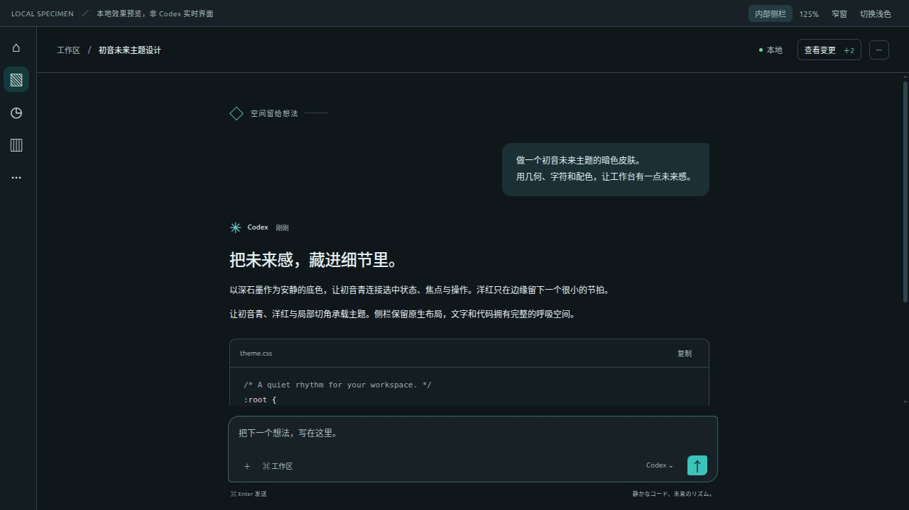

# MIKU / 01 · 1.0.1

初音未来主题的暗色 Codex 工作台：深石墨、初音青、少量洋红，以及输入框局部切角。保留原生顶栏和侧栏结构，不添加字符徽标、顶部留白、双轨线或角落装饰。



*仅导航栏布局的独立效果预览；此图片只用于文档展示。*

项目已迁移至 `/home/inkem/Personal/codex-miku-skin/`，原始应用备份、当前安装记录也随项目迁移至 `.state/`。该目录为私有目录，不应打包或提交到 Git。

## 更新当前已安装的皮肤

```bash
bash /home/inkem/Personal/codex-miku-skin/install.sh update
```

如果提示 `sudo` 密码，请在本机终端输入系统密码。更新完成后保存工作，手动退出并重新打开 Codex。工具不主动关闭应用。

本次修订移除了两个在真实客户端中不稳定的装饰：顶栏没有稳定的字符标记空间；图像、资料库等无内部侧栏的页面会把双轨线带到全局导航栏。现在完整侧栏和窄导航栏均不添加这些装饰。

`update` 只替换已校验的皮肤资源，不重写现有配色或字体设置。它保留首次安装前的配置记录；失败时恢复更新前的皮肤，中断后可继续。新补丁始终从原始备份生成，不叠加旧版 CSS。

## 初次安装与卸载

仅支持 Linux / Codex **26.1023.51421** 的已核实构建。版本号或整个 ASAR 的原始 SHA-256 不匹配时停止操作。

```bash
# 未安装过此皮肤时使用
bash /home/inkem/Personal/codex-miku-skin/install.sh install

# 恢复原应用资源和首次安装前的相关外观设置
bash /home/inkem/Personal/codex-miku-skin/uninstall.sh
```

卸载保留用户安装后自行修改的外观值及所有其他配置；备份也继续保留。Codex 升级或资源出现未知修改时停止覆盖，不能把旧版 ASAR 恢复到新版应用。

依赖 Python 3.11+ 与 `tomlkit`。脚本会检查当前 Python 和本机 Miniconda；也可用 `MIKU_PYTHON` 指定解释器。

## 状态、补丁准备与测试

```bash
bash /home/inkem/Personal/codex-miku-skin/install.sh status

# 仅准备修订补丁，不修改当前应用或配置
bash /home/inkem/Personal/codex-miku-skin/install.sh prepare-update

# 回归测试仅操作临时样本
/home/inkem/miniconda3/bin/python3 -B /home/inkem/Personal/codex-miku-skin/test_install.py
```

状态输出的 `updateAvailable` 表示源代码与当前已安装样式是否不同；`updatePrepared` 表示更新补丁已准备好。系统应用目录需要管理员权限，源码迁移本身不会改变正在运行的客户端。

## 预览

用浏览器打开 `preview.html`。其中的「仅导航栏」按钮模拟图像、资料库一类没有内部侧栏的页面结构；还可以检查暗色／浅色、窄窗、125% CSS 缩放、长对话、差异视图与弹窗。它是独立的视觉样本，不是真实 Codex 界面，不包含真实对话。

`miku.codex-theme` 可单独通过 Codex 原生主题导入功能使用。完整安装或更新时不需要再次导入。现有应用图标保留；新增皮肤没有图片、SVG、外部字体、资源 URL 或循环动画。

## 资源与恢复机制

- 补丁只修改 ASAR 中 `webview/index.html` 的索引项，并在数据末尾追加带有唯一标记的 HTML 样式。不更改业务 JavaScript、安全策略、原有数据区和其他资源索引。
- ASAR 原数据偏移保持不变。原始资源和每个待安装补丁都通过 SHA-256 检查，使用临时文件、同步和原子重命名替换。
- 原始文件为 `.state/original.asar`；首次安装版本副本为 `.state/patched.asar`；修订副本为 `.state/revision-*.asar`。以 `.state/state.json` 中的 `patchedFile`、`patchedSha256` 为当前版本依据。
- 更新准备记录在 `.state/update.json`，提交成功后删除。配置恢复依据始终为首次安装时记录的三个相关外观设置，不包含完整配置或账号凭据。
- 默认备份路径在项目自身的 `.state/`，不再依赖旧聊天目录层级。移动整个项目连同 `.state/` 后仍可更新和卸载。
- `MIKU_STATE_DIR`、`MIKU_CONFIG`、`MIKU_PYTHON` 可覆盖备份目录、配置路径和解释器；底层 Python 工具支持 `--app`、`--config`、`--state-dir`。

`VALIDATION.md` 记录本修订的测试与实际安装状态。`SHA256SUMS` 校验交付源码；`.state/` 与 `work/` 不包含在分发包中。
